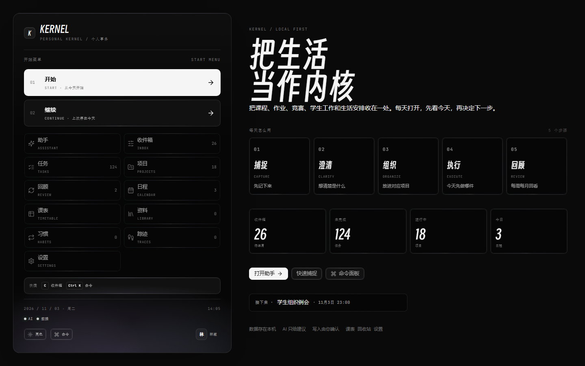
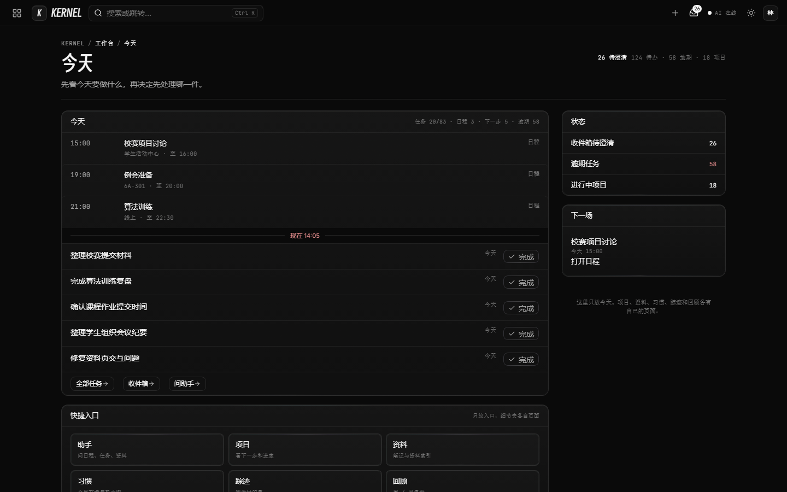
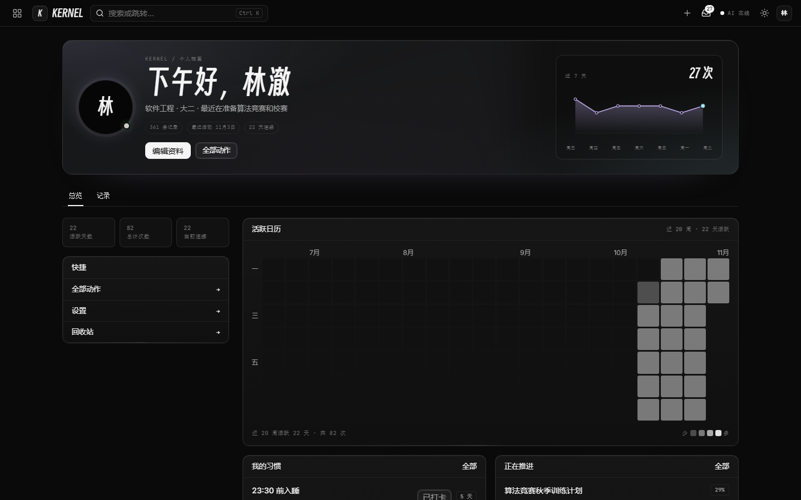
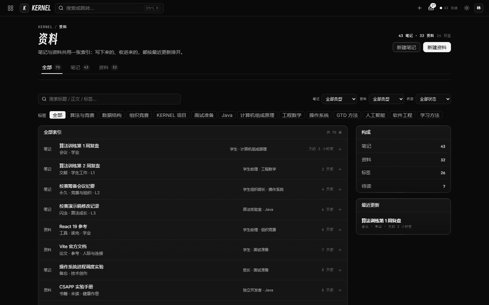
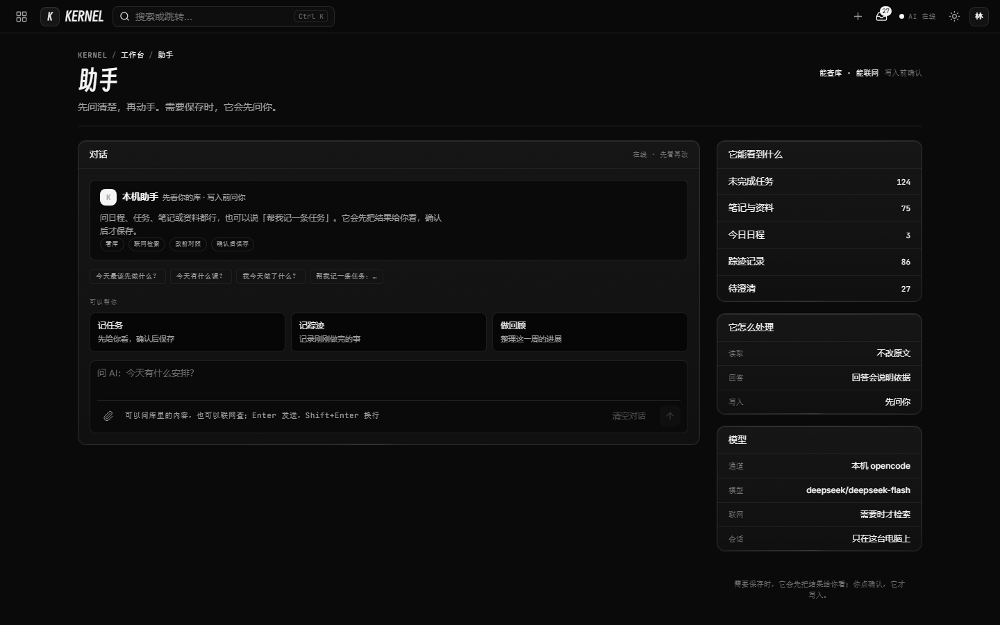

# KERNEL

> 文件即数据库，opencode 即大脑，网页即驾驶舱。

KERNEL 是一个本地优先的个人事务系统：课表、任务、日程、项目、笔记、资料、习惯、踪迹和回顾，都收在同一个地方。数据是你自己电脑上的 JSON 文件；AI 由本机 opencode 代理，模型请求会发往 DeepSeek（内容会出网，Key 只存本机）。

> 当前发布：**v1.1.0**（本地单用户正式版，Windows 安装包见 [GitHub Releases](https://github.com/plmt3742/kernel/releases)）。
>
> 产品介绍站：**https://kernel-intro.pages.dev/**（Cloudflare Pages）。

它面向的不是某一个身份：学生、知识工作者、自由职业者、创作者，都可以把工作、学习和生活里的事务放进来。要解决的不是“再多一个待办”，而是当代年轻人常见的焦虑与失控感：事情散在聊天、文件、截图和多个 App 里，没时间记录，复杂事务又很难持续推进。KERNEL 用一条本地循环把记录、阅读、规划、执行和回顾收回到同一个地方。



## 开始菜单 + 独立页面

KERNEL 的第一层不是常驻侧栏，而是一个 4:6 的开始菜单：左边是「开始 / 继续」和全部页面入口，右边是系统介绍、每日流程、真实计数和快捷动作。进入具体页面后，不再被侧栏挤压，每个页面只承担自己的内容。

| 路由 | 页面 |
|---|---|
| `/` | 开始菜单 |
| `/m` | 手机入口（查阅 / 记录） |
| `/today` | 今天 |
| `/assistant` | 助手 |
| `/inbox` | 收件箱（待澄清 / 已澄清 / 已丢弃） |
| `/tasks` · `/tasks/:id` | 任务与任务详情 |
| `/projects` · `/projects/:id` | 项目与项目详情 |
| `/library` · `/library/:kind/:id` | 资料 / 笔记索引与详情 |
| `/habits` · `/habits/:id` | 习惯与习惯详情 |
| `/traces` · `/traces/:id` | 踪迹与踪迹详情 |
| `/review` | 回顾（本周 / 本月 / 归档 / 动作） |
| `/calendar` · `/timetable` | 日程与课表 |
| `/profile` | 个人页 |
| `/settings/:section` | 设置分区 |
| `/trash` | 回收站 |



## 视觉与交互

- 暗色主界面：近黑、玻璃、发丝、Smiley Sans 展示字、等宽索引。
- 结构层级参考 GitHub：页面头、列表、tabs、详情页、面包屑，而不是把所有模块塞进一屏。
- **Pearl Rim**：鼠标悬停时只在组件边缘出现 1px 珍珠虹彩高光，颜色来自最初的 W4 设计稿：
  `#CDBBFF` / `#A9ECFF` / `#BEFFE1` / `#FFD6AA`。
- 指针光带惯性（lerp），不是硬跟随；组件有浮起、按下压缩、内阴影和轻微 3D 倾斜。
- 支持 `prefers-reduced-motion`；触控设备不启用指针光。
- 亮色模式有独立的对比度处理，主按钮、弱文本和链接不会出现「看不见」的问题。



## 能做什么

- **收件箱**：把一句话、一张截图、一个文件、一个链接丢进去。AI 先读一遍，给出「这该变成什么」的建议——任务、日程、笔记、资料还是项目——你确认后才写入。
- **文件速读**：PDF、Word、文本和截图可以先进入收件箱；AI 提取摘要、日期、关键事项与可行动项，先做价值筛查，再决定保存、拆任务还是丢弃。
- **任务 / 项目**：截止时间、优先级、子任务、下一步；项目有「进行中 / 暂停 / 将来 / 已完成」状态和真实完成度。
- **日程 / 课表**：日程按天排，支持新建、编辑、状态与回收站；课表是独立页面，支持单双周、连堂合并和按周切换。
- **资料 / 笔记**：笔记用 Markdown，可以逐层「蒸馏」；文件投递会自动附简介，原文和文件位置都保留。资料详情页直接预览 PDF / 图片 / 文本 / Word / PPT / Excel（Excel 显示为表格）；文件可用系统默认程序打开。
- **习惯 / 踪迹**：习惯支持打卡、连续天数与热力图；踪迹可以记一句「我刚刚做了什么」，也可以从收件箱和对话识别。
- **回顾**：每周 / 每月报告，自动归档；本周、本月、归档和动作记录分开查看。
- **个人页**：身份、简介、头像、活跃日历、我的习惯、正在推进、最近完成、最近踪迹和最近动作。
- **助手**：直接问库里的日程、任务、笔记和资料；需要写入时会先给你看结果，点确认后才保存。





> README 截图使用本地演示数据，人物昵称「林澈」为演示占位，不对应真实个人。

## 不是“待办 + 笔记”的拼装

常见的待办软件擅长任务清单，笔记软件擅长记录，AI 工具擅长问答；但真实生活里，一件事往往同时包含“文件、时间、行动、资料和回顾”。把它们拆进不同 App，用户就要不断切换、重复录入，最后还是靠脑子记。

KERNEL 的做法是：

- **先收下，再分类**：任何东西先进入收件箱，不要求用户当场想清楚。
- **AI 只做建议层**：读取、摘要、提取日期与行动项，但写入前一定确认。
- **统一事务循环**：任务、日程、项目、笔记、资料、习惯、踪迹、回顾共享同一套数据与导航。
- **本地优先**：数据是可读、可备份、可迁移的文件；AI 由本机 opencode 代理，不把数据锁在云端。

## 技术架构

浏览器里是 Vite + React 19 + TypeScript，样式用原生 CSS 变量，没有 UI 框架，没有 Tailwind。真正动数据的是一个本机 Node 进程（`server/`）：

- 唯一写入口：Zod 校验 → 原子写入 → 追加审计日志
- 提供 `/api`，同时代理 AI 请求
- 数据在 `data/`，一记录一文件，UTF-8，ID 稳定（`t-0001` 式）
- 进度、计数、状态聚合等派生值不落盘，运行时计算

```
浏览器 ──/api──▶ 数据服务 127.0.0.1:4097 ──▶ data/*.json
                     │
                     └──▶ opencode serve 127.0.0.1:4096 ──▶ DeepSeek
```

两个服务都只监听 `127.0.0.1`，不会直接暴露到局域网。

## 快速开始

需要 Node.js **20.19+ 或 22.12+**（Vite 7 要求；推荐 22 LTS）。

```bash
npm install
npm run dev
```

打开终端打印的实际地址（默认 http://localhost:5173，占用时顺延）。`npm run dev` 启动数据服务与 Vite，并检查 opencode：4096 已有监听则复用，否则尝试启动 CLI；CLI 不可用时应用仍可运行，AI 状态以界面检查为准。

| 端口 | 是什么 |
|---|---|
| 5173 | 前端（Vite） |
| 4097 | 数据服务（唯一写入路径） |
| 4096 | opencode serve（AI） |

想一上来就有内容看，先跑 `npm run seed`，会写一份演示数据到 `data/`。

其他命令：

```bash
npm run build                # 生产构建
npm run preview -- --host    # 预览构建产物（含数据服务）
npm run dev:web              # 只开前端（数据服务离线时只读）
npm run server               # 只开数据服务
npm run verify               # build + syntax + privacy
npm run installer            # 构建 Windows 安装包
```

手机上用：连同一个 WiFi，`npm run dev -- --host`，然后手机打开 `http://<电脑局域网IP>:5173`。打开首页时窄屏会自动进入 `/m` 手机入口（查阅 / 记录）；手机端是独立设计，不提供完整版入口。前端与数据服务默认只监听本机，局域网访问需显式 `--host`，并确认防火墙放行 5173。

## 环境变量与依赖

环境变量模板见 [`.env.example`](.env.example)。仓库只保留模板，真实值不入库；请在启动终端中设置为进程环境变量，数据服务不会自动读取 `.env` 文件。

| 变量 | 用途 |
|---|---|
| `DEEPSEEK_API_KEY` | DeepSeek API Key；也可在「设置 → AI 集成」填写，保存在本机 `data/meta/secrets.json` |
| `OPENCODE_SERVER_PASSWORD` | 数据服务与 opencode serve 之间的可选访问口令 |
| `KERNEL_OPENCODE_URL` | opencode serve 地址，默认 `http://127.0.0.1:4096` |
| `KERNEL_OPENCODE_BIN` | opencode 可执行文件路径；留空则从系统 `PATH` 查找 |

依赖清单以 [`package.json`](package.json) 与 [`package-lock.json`](package-lock.json) 为准；Node.js 要求 `^20.19.0 || >=22.12.0`。主要依赖：

- **前端**：React 19、React Router 7、Motion 12、cmdk、react-markdown + remark-gfm、date-fns、lucide-react
- **服务端**：zod 4、write-file-atomic 8、@opencode-ai/sdk 1.18（原生 `node:http`，无 Web 框架）
- **构建 / 分发**：Vite 7、TypeScript 5、Inno Setup 编译器

## Windows 安装包

不想装 Node.js，就用安装包：

1. 从 GitHub Releases 下载 `KERNEL-Setup-x.y.z.exe`；
2. 双击，选择用户可写的 `<安装目录>`；
3. 装完从开始菜单或可选的桌面图标启动，无需另装 Node.js 或 opencode；AI 仍需配置模型凭据。

数据在 `<安装目录>\data`，和程序放在一起，整个文件夹能直接拷到别的电脑。卸载时程序删掉，`data\` 会保留。

安装包由 `scripts/build-installer.mjs` 打包（使用仓库内置的 Inno Setup 编译器），脚本在 `installer/KERNEL.iss`。

## 微信通知（Phase 1）

设置 → 通知：填入企业微信群机器人 webhook，保存后可「测试推送」。数据服务会在后台定时发送每日简报（默认 08:00）与任务到期提醒（默认提前 30 分钟）；失败按 1 / 5 / 15 分钟退避，状态在设置页可查。

- webhook URL 与入站 token 只存本机 `data/meta/secrets.json`（gitignore，不回显、不入库）。
- 入站预留 `POST /api/wechat/inbound`（`Authorization: Bearer <token>`、仅 `127.0.0.1`、`msgId` 幂等）。
- 个人微信非官方协议（itchat / wechaty / PC 注入）有封号风险，明确不接入。

## AI 实现

- **编码代理**：opencode（本机 `127.0.0.1:4096`），负责收件箱解析、回顾草稿、助手对话等结构化任务。
- **模型**：DeepSeek（默认 `deepseek/deepseek-flash`），走 DeepSeek API；Key 只存本机（环境变量，或「设置 → AI 集成」）。
- **链路**：浏览器 → 本机数据服务 → opencode serve → DeepSeek。模型请求会出网，业务数据仍只落本机。
- **确认后写入**：AI 只产出结构化提案，用户确认后才经唯一写入口落盘；对话与草稿默认不落库。

## 当前边界与下一步

KERNEL 目前是本地单用户版本，先把“个人事务闭环”跑通。移动端目前是独立入口 `/m`（查阅 + 记录，不提供完整版入口），完整移动版、多人协作和插件体系仍在规划中；AI 依赖本机 opencode 服务，服务离线时仍可手动记录、整理和回顾。

下一步会做两件事：

- **用户社区**：共享模板、复盘方法、项目拆解方式和文件处理工作流。
- **插件体系**：让日历、文件、模型和自动化能力以插件方式接入，而不是继续把功能堆进主界面。

## 质量门禁

```bash
npm run build          # TypeScript + Vite 生产构建
npm run check:syntax   # server/ 与 scripts/ 语法检查
npm run check:privacy  # 密钥 / 本机路径 / 私有数据扫描
npm run verify         # 上述三项
```

## 项目结构

```text
src/            React 19 + TypeScript 前端（页面 / 组件 / 派生逻辑）
server/         本机数据服务（唯一写入口 / Zod / 原子写 / 审计 / AI 代理 / 通知）
scripts/        开发、种子数据、打包与检查脚本
public/         静态资源、字体与使用指南
installer/      Windows 安装包定义与启动页
site/           产品介绍站（独立静态站，已部署 Cloudflare Pages）
assets/         README 截图
data/           运行时数据（gitignore，不入库）
```

## 产品介绍站

**线上地址：https://kernel-intro.pages.dev/**

`site/` 是一个独立的单页介绍站：章节式阅读动线（00–06）+ 粘性五步循环结构演示 + 本机数据流图 + 动效与高级交互组件；暖灰近黑 + 哑光黄铜的暗色，2–4px 圆角，零构建、零外链，字体与截图全部本地。用任意静态服务器以 `site/` 为根预览：

```bash
python -m http.server 4177 -d site
```

已部署到 Cloudflare Pages（https://kernel-intro.pages.dev/），以 `site/` 为输出目录，不需要构建命令。介绍站不参与 `npm run dev`，但会随安装包一起分发（应用「关于 → 产品介绍」可离线打开）；不改变应用路由，应用本身仍只在本机运行。

## 团队信息

| 项 | 内容 |
|---|---|
| 团队名称 | 巴巴博弈小组 |
| 队长 | 林敬翔 |
| 团队成员 | 马天宝、王梓涛 |
| 学校 | 东莞理工学院 |
| 学院 / 专业 | 计算机学院 · 工业软件专业（大二） |
| 指导教师 | 姚晓曼 |

| 成员 | 分工 |
|---|---|
| 林敬翔 | 项目负责人 / 队长：产品定义与范围裁决、总体架构、数据服务与数据模型、AI 链路、核心功能、发布与最终合并审查 |
| 马天宝 | 移动端设计与适配：移动端全量界面设计稿（13 路由形态、token 映射、390 宽度自检）；手机端触控 / 弹窗 Phase 1 适配 |
| 王梓涛 | 工程与文档 / 外部集成：工程文件审计与版本口径同步、文档索引 / CI / 质量门禁、微信通道 Phase 1（企业微信群机器人 + 本机入站预留） |

应用本身只在本机运行，不发布到公网；介绍站可单独部署。
