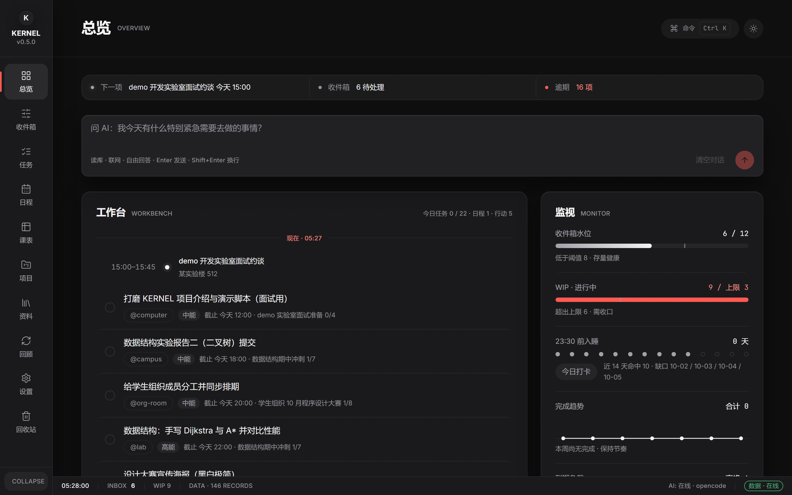
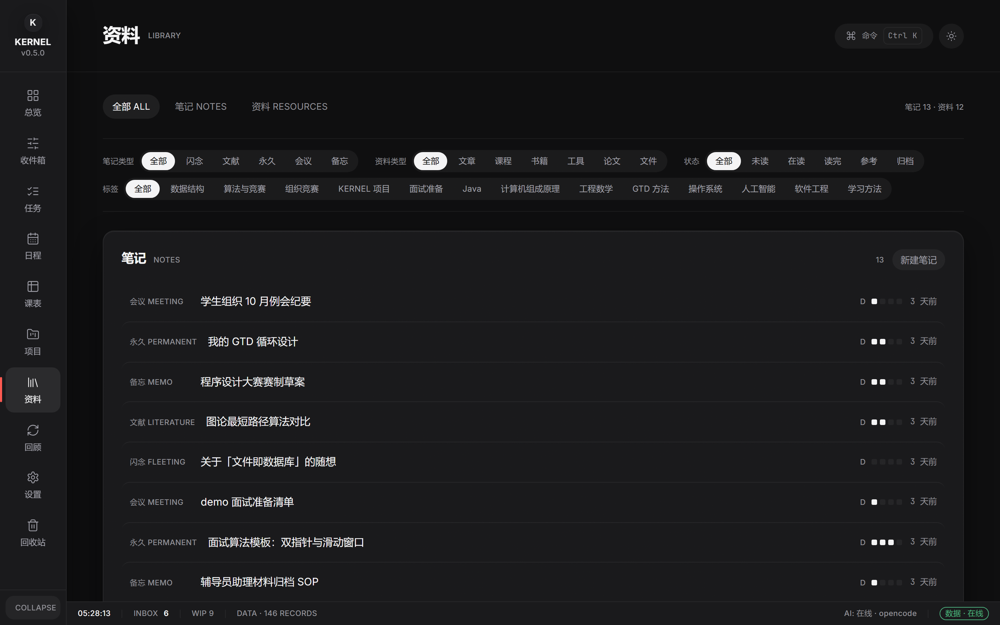

# KERNEL

> 文件即数据库，opencode 即大脑，网页即驾驶舱。

KERNEL 是一个本地优先的个人事务工具：课表、任务、日程、项目、资料、笔记和复盘收在一个地方。数据是你自己电脑上的 JSON 文件；AI 由本机 opencode 代理，但模型请求会发往 DeepSeek（内容会出网，Key 只存本机）。



项目名来自操作系统内核：进程对应任务 / 项目，内存对应资料，I/O 对应收件箱，调度器对应日程，GC 对应回顾。

系统不按身份分区——学生、助理、竞赛负责人这些身份都只是标签，在视图里筛。一级导航只有一套通用循环：捕捉 → 澄清 → 组织 → 执行 → 回顾。

## 快速开始

需要 Node.js **20.19+ 或 22.12+**（Vite 7 要求；推荐 22 LTS）。

```bash
npm install
npm run dev
```

打开终端打印的实际地址（默认 http://localhost:5173，占用时顺延）。`npm run dev` 启动数据服务与 Vite，并检查 opencode：4096 已有监听则复用，否则尝试启动 CLI；CLI 不可用时应用仍可运行，AI 状态以界面检查为准。

| 端口 | 是什么 |
|---|---|
| 5173 | 前端（Vite） |
| 4097 | 数据服务（唯一写入路径） |
| 4096 | opencode serve（AI） |

想一上来就有内容看，先跑 `npm run seed`，会写一份演示数据到 `data/`。

其他命令：

```bash
npm run build                # 生产构建
npm run preview -- --host    # 预览构建产物（含数据服务）
npm run dev:web              # 只开前端（数据服务离线时只读）
npm run server               # 只开数据服务
npm run installer            # 打 Windows 安装包（见下）
```

手机上用：连同一个 WiFi，`npm run dev -- --host`，然后手机打开 `http://<电脑局域网IP>:5173`。前端与数据服务默认只监听本机，局域网访问需显式 `--host`，并确认防火墙放行 5173。

## Windows 安装包

不想装 Node.js，就用安装包：

1. 从 GitHub Releases 下载 `KERNEL-Setup-x.y.z.exe`；
2. 双击，选择用户可写的 `<安装目录>`（保留安装器默认位置也可以）；
3. 装完从开始菜单或可选的桌面图标启动，无需另装 Node.js 或 opencode；AI 仍需配置模型凭据。启动器拉起本地服务与 Vite 开发服务器，默认浏览器入口为 `http://localhost:5173`，并非生产预览。

数据在 `<安装目录>\data`，和程序放在一起，整个文件夹能直接拷到别的电脑。卸载时程序删掉，`data\` 会保留。

安装包由 `scripts/build-installer.mjs` 打包（用仓库内置的 Inno Setup 编译器，不用另外装），脚本在 `installer/KERNEL.iss`。

## 微信通知（Phase 1）

设置 → 通知：填入企业微信群机器人 webhook，保存后可「测试推送」。数据服务会在后台定时发送每日简报（默认 08:00）与任务到期提醒（默认提前 30 分钟）；失败按 1 / 5 / 15 分钟退避，状态在设置页可查。

- webhook URL 与入站 token 只存本机 `data/meta/secrets.json`（gitignore，不回显、不入库）。
- 入站预留 `POST /api/wechat/inbound`（`Authorization: Bearer <token>`、仅 `127.0.0.1`、`msgId` 幂等），Phase 2 中继直接调用。
- 个人微信非官方协议（itchat / wechaty / PC 注入）有封号风险，明确不接入。

## 能做什么

- **收件箱**：把一句话、一张截图、一个文件丢进去。AI 先读一遍，给出「这该变成什么」的建议——任务、日程、笔记还是资料——你确认后才写库，它不会自作主张。
- **任务 / 项目**：截止时间、优先级、子任务；项目有「下一步」和状态（进行中 / 暂停 / 将来 / 已完成）。
- **日程 / 课表**：日程按天排，也能翻已结束的；课表是单独一页，支持单双周、连堂合并、按周切换。
- **资料 / 笔记**：笔记用 Markdown，可以逐层「蒸馏」成更短的版本；投进来的文件会自动附一句简介。
- **踪迹**：随手记一句「我刚刚做了什么」（可配图），按时间排成动态流或时间线；也能让 AI 从收件箱、对话里替你识别入账。
- **微信通知（Phase 1）**：企业微信群机器人 webhook 仅出站；每日简报 / 任务到期提醒 / 测试推送，设置 → 通知配置；webhook 与 token 只存本机。



- **回顾**：每周 / 每月出一份复盘报告，AI 写、自动归档，可翻历史。
- **总览**：直接问库里的日程、任务、笔记；也能让它改某个日程的时间——改之前先给你看新旧对照，点「应用」才写。

## 技术架构

浏览器里是 Vite + React 19 + TypeScript，样式用原生 CSS 变量，没有 UI 框架。真正动数据的是一个本机 Node 进程（`server/`），它同时干三件事：唯一写入口（Zod 校验 → 原子写 → 追加审计日志）、给前端提供 `/api`、代理 AI 请求。

```
浏览器 ──/api──▶ 数据服务 127.0.0.1:4097 ──▶ data/*.json
                     │
                     └──▶ opencode serve 127.0.0.1:4096 ──▶ DeepSeek
```

两个服务都只监听 `127.0.0.1`，不会暴露到局域网。

数据就是文件：`data/` 下一记录一文件，ID 稳定（`t-0001` 式），UTF-8。可以直接 diff、备份、整目录迁移。进度、计数这类派生值不落盘，运行时算。

## 环境配置

**运行环境**：Node.js **20.19+ 或 22.12+**（推荐 22 LTS）、npm；Windows 10 / 11（直接跑 Windows 侧，不用 WSL）。

**依赖**：`react` `react-dom` `react-router-dom` `zod` `write-file-atomic` `@opencode-ai/sdk` `date-fns` `clsx` `cmdk` `motion` `lucide-react` `react-markdown` `remark-gfm` `@fontsource-variable/inter` `@fontsource/jetbrains-mono`
**开发依赖**：`vite` `typescript` `@vitejs/plugin-react` `@types/react` `@types/react-dom` `innosetup-compiler`

**环境变量**（模板见 [`.env.example`](.env.example)）：

| 变量 | 用途 | 默认 |
|---|---|---|
| `DEEPSEEK_API_KEY` | AI 用的 DeepSeek Key | 空 |
| `KERNEL_OPENCODE_URL` | opencode serve 地址 | `http://127.0.0.1:4096` |
| `KERNEL_OPENCODE_BIN` | 指定 opencode 可执行文件 | 空（查 PATH） |
| `OPENCODE_SERVER_PASSWORD` | 数据服务 ↔ opencode 的本地口令 | 空 |

Key 也可以不写环境变量，直接在应用里填：设置 → AI 集成。它存在本机 `data/meta/secrets.json`（已 gitignore，不进版本库）。

## AI 实现

- **编码代理**：opencode（本机 `127.0.0.1:4096`），负责收件箱解析、回顾草稿、总览对话等结构化任务。
- **模型**：DeepSeek（默认 `deepseek/deepseek-flash`），走 DeepSeek API；Key 只存本机（环境变量，或「设置 → AI 集成」）。
- **链路**：浏览器 → 本机数据服务 → opencode serve → DeepSeek。模型请求会出网，业务数据仍只落本机。
- **确认后写入**：AI 只产出结构化提案，用户确认后才经唯一写入口落盘；对话与草稿默认不落库。

## 质量门禁

```bash
npm run build          # TypeScript + Vite 生产构建
npm run check:syntax   # server/ 与 scripts/ 语法检查
npm run check:privacy  # 密钥 / 本机路径 / 私有数据扫描
npm run verify         # 上述三项
```

## 项目结构

```text
src/            React 19 + TypeScript 前端（视图 / 组件 / 派生逻辑）
server/         本机数据服务（唯一写入口 / Zod / 原子写 / 审计 / AI 代理 / 通知）
scripts/        开发、种子数据、打包与检查脚本
public/         静态资源与使用指南
installer/      Windows 安装包定义与启动页
assets/         README 截图
data/           运行时数据（gitignore，不入库）
```

## 团队信息

| 项 | 内容 |
|---|---|
| 团队名称 | 【待填写】 |
| 团队成员 | 【待填写】 |
| 组别 | 【待填写】 |
| 学校 | 【待填写】 |
| 指导教师 | 【待填写】 |

本项目只在本机运行，不发布到公网。
